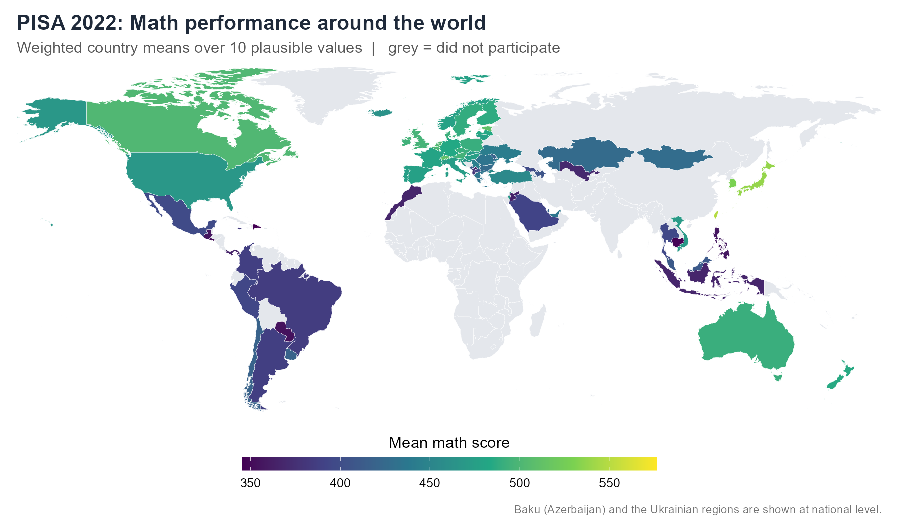
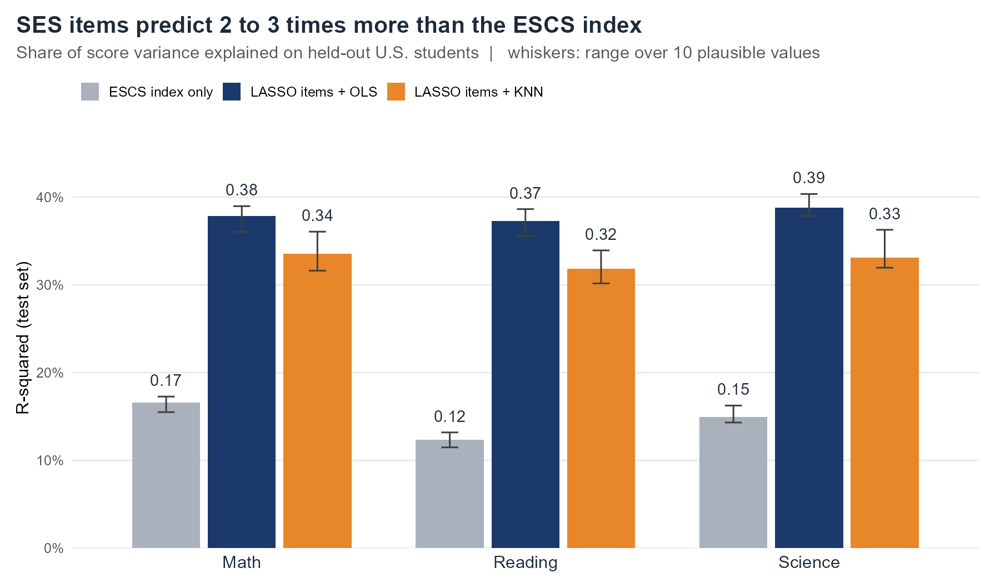
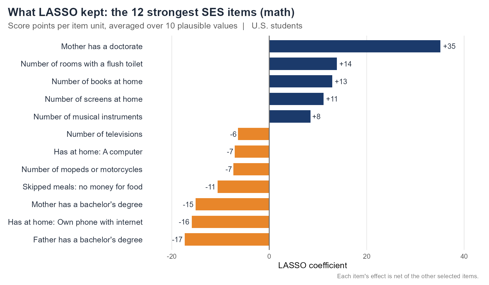
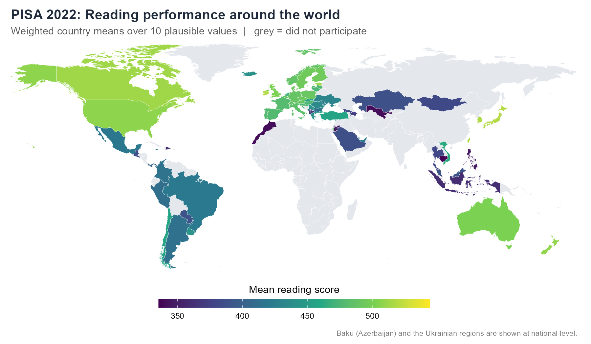
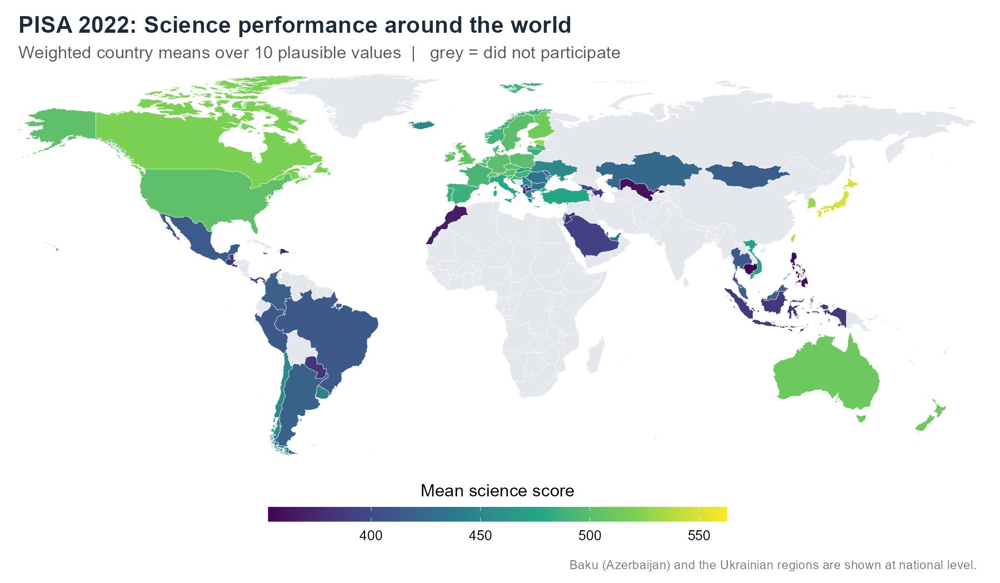
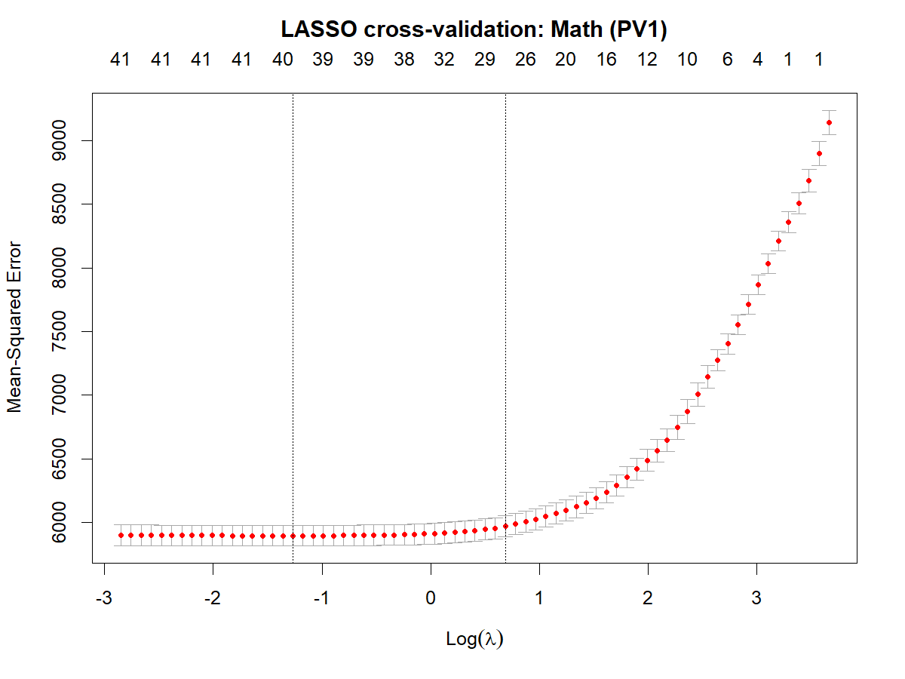
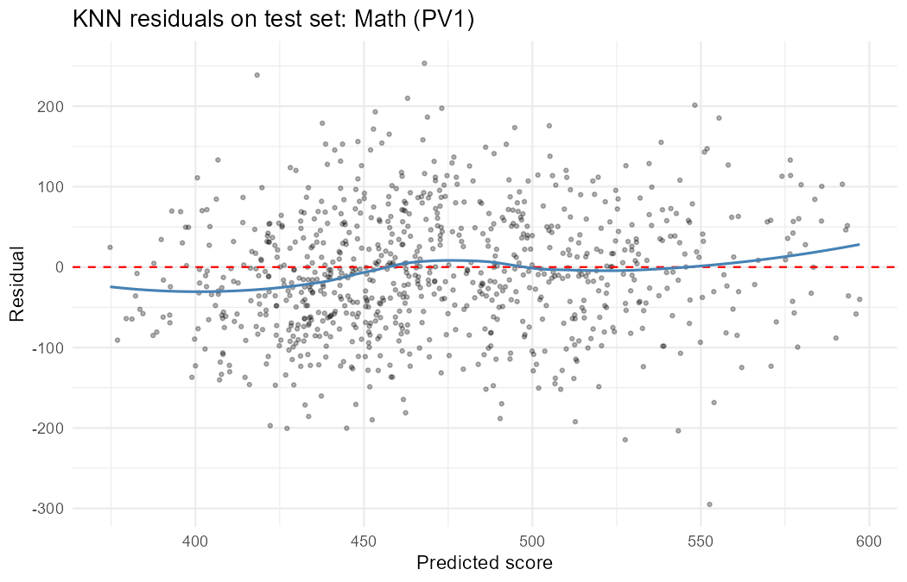
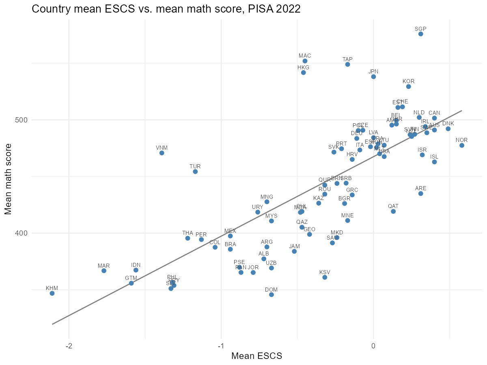
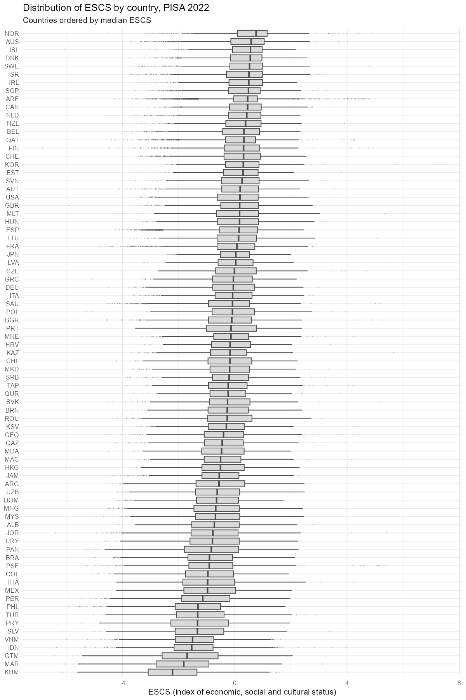

# How Much Does Family Background Predict Achievement? LASSO + KNN on PISA 2022

R pipeline that measures how well socioeconomic (SES) survey items predict 15-year-olds' math, reading and science scores in the OECD PISA 2022 data (80 education systems, ~614,000 students), and which items matter most.

<a href="https://rumeysagorgulu.github.io/pisa2022-ses-achievement/"></a>

<p align="center"><a href="https://rumeysagorgulu.github.io/pisa2022-ses-achievement/"><b>Explore the interactive map</b></a>: switch between math, reading and science, and hover over any country.</p>

**Question:** How much achievement variance can home and family background items predict on unseen students, and does a non-linear model (KNN) predict better than a linear one?

**Answer in one line:** individual SES survey items explain **37–39%** of score variance for held-out U.S. students, 2 to 3 times more than the ESCS index alone (12–17%), and a simple linear model beats KNN.

**Design**
- **Data:** ~40 SES survey items (home possessions, books, parental education and occupation, food insecurity)
- **Sample:** U.S. students, with a fixed 80/20 train/test split
- **Feature selection:** LASSO, 10-fold CV, λ = 1se
- **Models compared:** OLS on ESCS only, OLS on the LASSO-selected items, and KNN on the same items (k tuned by 10-fold CV)
- **Plausible values:** every model is fit once per plausible value (PV1–PV10) and the metrics are averaged across the 10 runs, following standard practice for PISA scores

## Results (U.S. test set)

| Subject | Model | R² | RMSE | MAE |
|---|---|---|---|---|
| Math | OLS: ESCS only | 0.166 (0.155–0.173) | 86.4 (83.8–87.7) | 69.4 (67.1–70.9) |
| Math | OLS: selected items | 0.378 (0.360–0.390) | 74.6 (72.0–76.6) | 59.2 (57.4–61.2) |
| Math | KNN: selected items | 0.336 (0.316–0.361) | 77.1 (73.7–78.9) | 61.4 (58.9–62.7) |
| Reading | OLS: ESCS only | 0.124 (0.115–0.132) | 101.8 (99.0–104.2) | 81.3 (79.3–82.4) |
| Reading | OLS: selected items | 0.373 (0.356–0.386) | 86.1 (83.5–88.6) | 68.1 (65.7–70.0) |
| Reading | KNN: selected items | 0.319 (0.302–0.339) | 89.8 (86.4–92.1) | 70.9 (68.5–72.6) |
| Science | OLS: ESCS only | 0.149 (0.143–0.163) | 99.5 (97.2–101.5) | 80.6 (78.6–82.7) |
| Science | OLS: selected items | 0.388 (0.379–0.404) | 84.4 (81.7–86.4) | 66.6 (64.4–68.7) |
| Science | KNN: selected items | 0.331 (0.320–0.363) | 88.2 (84.5–90.3) | 70.2 (67.1–72.1) |

Values are means across the 10 plausible values, with the min–max range in parentheses. PISA scores have SD ≈ 100.

**Key findings**

- **The composite index misses a lot:** SES items explain about 37–39% of score variance in held-out U.S. students, versus 12–17% for the ESCS index alone.
- **KNN does not improve on the linear model** (R² 0.32–0.34 vs. 0.37–0.39), suggesting that the SES–achievement relation is mostly additive.
- **Results are stable across plausible values:** the R² range across PV1–PV10 is about ±0.02, so the conclusions do not depend on which plausible value is used.

### LASSO + OLS vs. KNN vs. the ESCS index



### What LASSO kept



Parental education at the highest level, books and household resources carry the strongest positive signal; food insecurity is negative. Each coefficient is net of the other selected items, so some related items (for example, a parent's bachelor's degree alongside a doctorate) take negative values.

<details>
<summary><b>More figures</b>: reading and science maps, LASSO cross-validation, KNN residuals, ESCS by country</summary>
<br>

| Reading | Science |
|---|---|
|  |  |

| LASSO cross-validation (math) | KNN residuals on the test set (math, PV1) |
|---|---|
|  |  |

| Country mean ESCS vs. math | ESCS by country |
|---|---|
|  |  |

</details>

## Pipeline

| Step | Script | What it does |
|------|--------|--------------|
| 1 | `R/01_data_prep_eda.R` | Converts the 2 GB SPSS file to RDS. Handles missing data (excludes students missing more than 14 items; imputes the rest with country item means; imputes ESCS with country means; excludes Costa Rica, which has no ESCS). Computes weighted country statistics over all 10 PVs. |
| 2 | `R/02_visualization.R` | ESCS distribution by country; world maps of weighted country mean scores; country-level ESCS vs. math scatter; interactive Plotly versions |
| 3 | `R/03_modeling.R` | Per subject × PV: LASSO selection, then OLS / KNN fit and test-set scoring; pooled metrics, LASSO selection frequencies, figures, and a Markdown results table |
| 4 | `R/04_showcase_figures.R` | README figures and the interactive map (`docs/index.html`), built from the result files only |

Outputs go to `results/` (CSV tables) and `plots/` (figures).

## Methodological notes
- **Plausible values:** PVs are never averaged per student. Averaging understates measurement error and inflates R².
- **No leakage:** only SES items (or ESCS) are used as predictors. Other subjects' scores, student IDs and weights are excluded.
- **R²** is reported as 1 − SSE/SST on the test set (`yardstick::rsq_trad`), not as a squared correlation.
- **Weights:** country descriptive statistics use the final student weight `W_FSTUWT`. The predictive models are unweighted, because the goal is prediction accuracy on the sample, not population inference.
- **Limitations:**
  - Mean imputation of survey items shrinks their variance
  - Results come from a single train/test split, and the models are fit to U.S. data only

## Reproducing

1. Download the PISA 2022 Student Questionnaire (SPSS) from https://www.oecd.org/pisa/data/ and place `CY08MSP_STU_QQQ.SAV` in `data/`.
2. Install dependencies:
   ```r
   install.packages(c("haven", "tidyverse", "glmnet", "tidymodels", "kknn",
                      "countrycode", "maps", "plotly", "htmlwidgets"))
   ```
3. From the repository root, run:
   ```
   Rscript R/01_data_prep_eda.R
   Rscript R/02_visualization.R
   Rscript R/03_modeling.R
   Rscript R/04_showcase_figures.R
   ```
   Step 3 takes about 10–20 minutes.

## Changelog
- **v2.1:** new README figures (readable LASSO item labels, model comparison, larger maps) and an interactive map hosted with GitHub Pages
- **v2:**
  - Fixed target leakage: an earlier version let the KNN models use the other subjects' scores as predictors, which inflated R² to about 0.7
  - Models are now fit per plausible value
  - The KNN now uses the LASSO-selected items
  - Maps now show weighted country means
  - Added linear baselines

## License

MIT, see `LICENSE`.

## Author

Rumeysa Gorgulu
