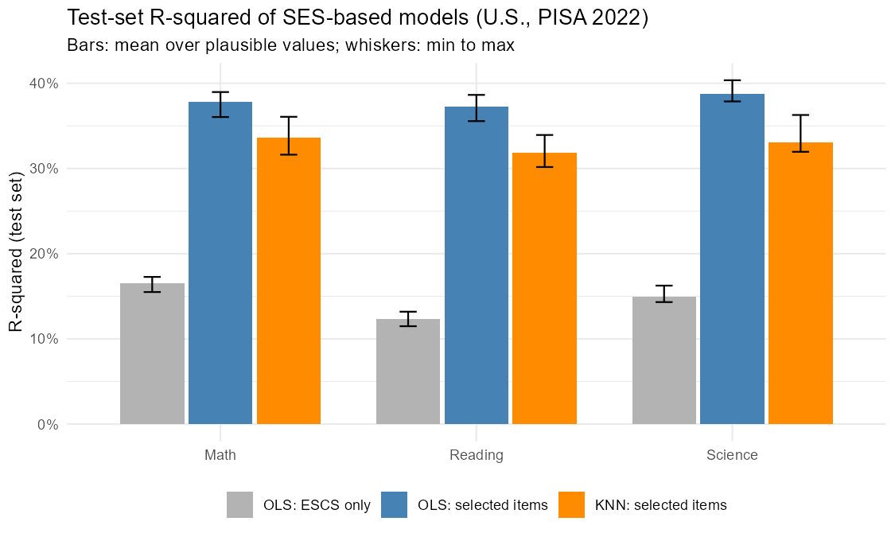
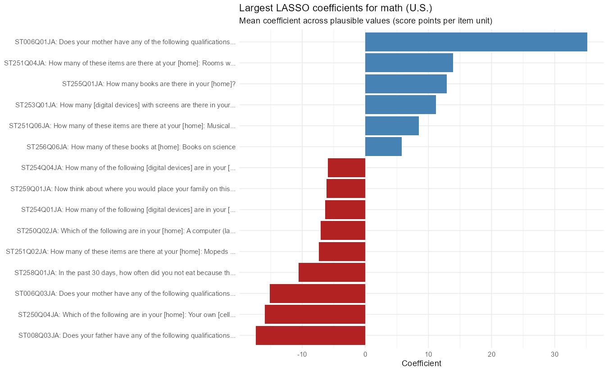

# How Much Does Family Background Predict Achievement? LASSO + KNN on PISA 2022

R pipeline that measures how well socioeconomic (SES) survey items predict 15-year-olds' math, reading and science scores in the OECD PISA 2022 data (80 education systems, ~614,000 students), and which items matter most.

**Question:** How much achievement variance can home and family background items predict on unseen students, and does a non-linear model (KNN) predict better than a linear one?

**Design**
- **Data:** ~40 SES survey items (home possessions, books, parental education and occupation, food insecurity)
- **Sample:** U.S. students, with a fixed 80/20 train/test split
- **Feature selection:** LASSO, 10-fold CV, λ = 1se
- **Models compared:** OLS on ESCS only, OLS on the LASSO-selected items, and KNN on the same items (k tuned by 10-fold CV)
- **Plausible values:** every model is fit once per plausible value (PV1–PV10) and the metrics are averaged across the 10 runs, following standard practice for PISA scores

## Results (U.S. test set)

<!-- Paste the contents of results/results_table.md here after running R/03_modeling.R -->

| Subject | Model | R² | RMSE | MAE |
|---|---|---|---|---|
| Math | OLS: ESCS only | … | … | … |
| Math | OLS: selected items | … | … | … |
| Math | KNN: selected items | … | … | … |

Values are means across the 10 plausible values, with the min–max range in parentheses. PISA scores have SD ≈ 100.

**Key findings** <!-- Write 2–3 bullets from your own numbers, e.g.: -->
- SES items explain about __% of score variance in held-out students, versus __% for the ESCS index alone.
- KNN does / does not improve on the linear model, suggesting that the SES–achievement relation is mostly additive / has non-linear structure.
- The items selected most consistently are: __ (see `results/lasso_selection.csv`).

| Model comparison | Top LASSO items (math) |
|---|---|
|  |  |

## Pipeline

| Step | Script | What it does |
|------|--------|--------------|
| 1 | `R/01_data_prep_eda.R` | Converts the 2 GB SPSS file to RDS. Handles missing data (excludes students missing more than 14 items; imputes the rest with country item means; imputes ESCS with country means; excludes Costa Rica, which has no ESCS). Computes weighted country statistics over all 10 PVs. |
| 2 | `R/02_visualization.R` | ESCS distribution by country; world maps of weighted country mean scores; country-level ESCS vs. math scatter; interactive Plotly versions |
| 3 | `R/03_modeling.R` | Per subject × PV: LASSO selection, then OLS / KNN fit and test-set scoring; pooled metrics, LASSO selection frequencies, figures, and a Markdown results table |

Outputs go to `results/` (CSV tables) and `plots/` (figures).

## Methodological notes
- **Plausible values:** PVs are never averaged per student. Averaging understates measurement error and inflates R².
- **No leakage:** only SES items (or ESCS) are used as predictors. Other subjects' scores, student IDs and weights are excluded.
- **R²** is reported as 1 − SSE/SST on the test set (`yardstick::rsq_trad`), not as a squared correlation.
- **Weights:** country descriptive statistics use the final student weight `W_FSTUWT`. The predictive models are unweighted, because the goal is prediction accuracy on the sample, not population inference.
- **Limitations:**
  - Mean imputation of survey items shrinks their variance
  - Results come from a single train/test split, and the models are fit to U.S. data only

## Reproducing

1. Download the PISA 2022 Student Questionnaire (SPSS) from https://www.oecd.org/pisa/data/ and place `CY08MSP_STU_QQQ.SAV` in `data/`.
2. Install dependencies:
   ```r
   install.packages(c("haven", "tidyverse", "glmnet", "tidymodels", "kknn",
                      "countrycode", "maps", "plotly", "htmlwidgets"))
   ```
3. From the repository root, run:
   ```
   Rscript R/01_data_prep_eda.R
   Rscript R/02_visualization.R
   Rscript R/03_modeling.R
   ```
   Step 3 takes about 10–20 minutes.

## Changelog
- **v2:**
  - Fixed target leakage: an earlier version let the KNN models use the other subjects' scores as predictors, which inflated R² to about 0.7
  - Models are now fit per plausible value
  - The KNN now uses the LASSO-selected items
  - Maps now show weighted country means
  - Added linear baselines

## License

MIT, see `LICENSE`.

## Author

Rumeysa Gorgulu
